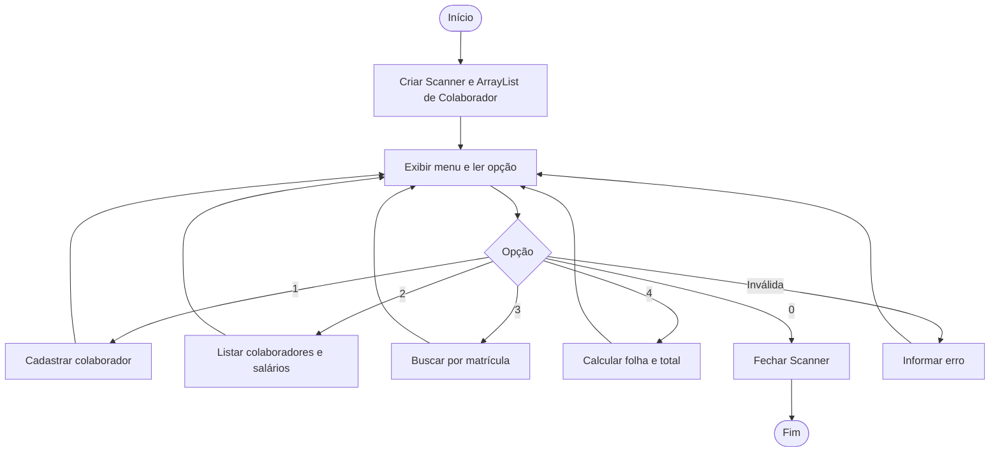
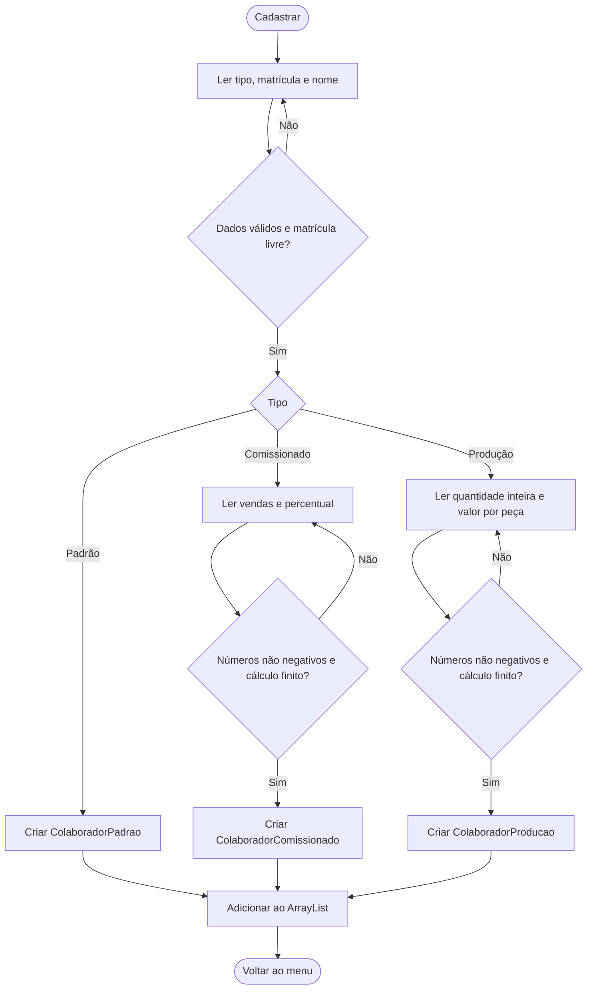
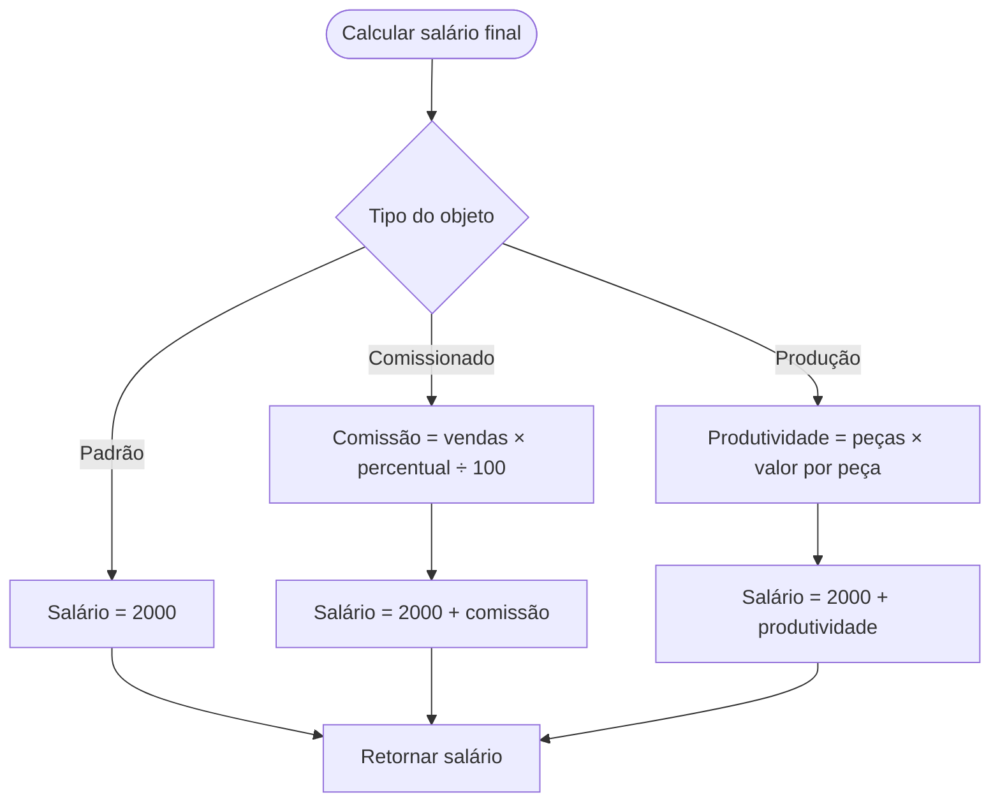

# Planejamento do sistema

Fluxogramas preparados antes da implementação. Os blocos abaixo usam Mermaid.

## Menu principal

## Cadastro e validação

## Cálculo por tipo

O programa repete cada campo inválido. Fim da entrada encerra o programa de forma controlada. A listagem e a folha chamam os métodos dos objetos por meio de referências do tipo Colaborador, aplicando polimorfismo.
